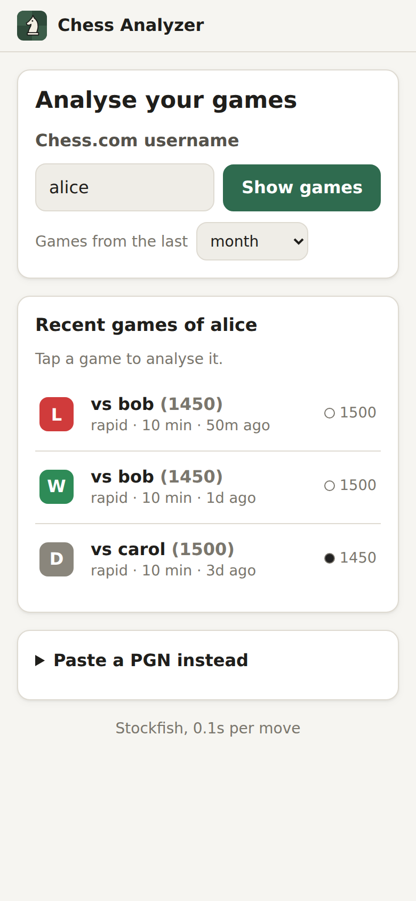
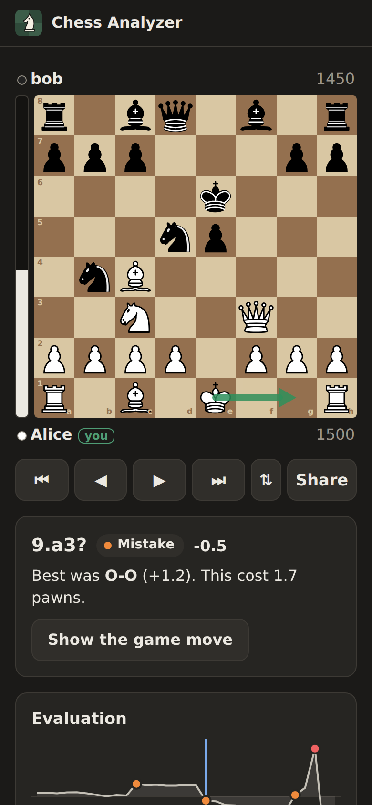

# Chess Game Analyzer

---
<p align="center">
  
  
  <a href="https://github.com/psf/black"></a>
</p>

## Introduction

Chess Game Analyzer downloads your recent games from Chess.com or Lichess, runs Stockfish over every move and checks the opening against established theory. Use it from your phone through the web app, or from the command line. For each game it reports:

- your accuracy in percent, the rating of a player who typically plays that accurately, your average centipawn loss and a Chess.com-style review: how many of your moves were brilliant, great, best, good, inaccuracies, mistakes, misses or blunders;
- your biggest mistakes, with the evaluation before and after, the move Stockfish preferred and what kind of error it was (a hung piece, a missed tactic, a spoiled endgame, …);
- how you used your clock: mistakes played in under 3 seconds, mistakes made in time trouble and long thinks on obvious moves;
- the move where you or your opponent left opening theory, and the book moves that score best from that position;
- whether you carried out the typical pawn breaks of your opening (such as ...c5 and ...f6 in the French Defense), or missed them when the engine wanted them;
- the critical moments: the few positions where only one move kept the game balanced, and whether you found it;
- for every move, an explanation in plain English of why it is good or bad: what it does, how the opponent punishes it and what the better move would have achieved, instead of just an engine line.
- a key takeaway at the end of each game: the move that turned it, what would have saved it and a tip for next time, or, after a game without mistakes, what to keep doing.

Every position where you missed the best move becomes a puzzle you solve by moving the pieces, and a spaced-repetition trainer brings each one back until you find it every time.

Across several games it shows how your accuracy develops over time, where you leave book in each opening, how often you play its pawn breaks and how you score with and without them, in which phase of the game you lose the most, and which kinds of mistakes you make most often. It names the weaknesses that keep coming back in one place, such as "You miss tactics in the endgame" or "You spend a lot of time in the opening of the Caro-Kann Defense", with the puzzles from your own games to practise them. It also compares you with other players at your rating, so you know which part of your game lags behind for your level.

## Table of Contents 🗂

- [Web app](#web-app)
- [Deploying it on a Raspberry Pi](#deploying-it-on-a-raspberry-pi)
- [Command line](#command-line)
- [Technical details](#technical-details)
- [Citation](#citation)
- [Contributing](#contributing)
- [License](#license)

## Web app 📱

<p align="center">
  
  
</p>

The web app is the easiest way to use the analyzer from a phone. Choose Chess.com or Lichess, enter your username and tap a game. Stockfish analyses it, and the page shows:

- the board with an evaluation bar. Step through the moves with the arrows, by swiping the board or by tapping a move;
- your own moves: move a piece on the board (tap it and then its square, or drag it) to see what would have happened. It starts a line of your own from that position, which you can extend, step through with the arrows and leave with **Back to the game** or Esc;
- the engine's top three lines in the position shown, with their evaluations, when you turn on ≡ below the board. Stockfish works them out in your browser as you step through the game or your own line, and the evaluation bar follows them. Tap a line to play it out on the board. Before one of your own misses whose answer you haven't looked at, they stay hidden, like the best move;
- each move's classification. Inaccuracies, mistakes and blunders also show the engine's best move, and "Show best move" draws it on the board; hovering over the best move's name previews it. The ↗ button below the board always draws the engine's best move in the position shown, so you can follow the engine's choices through the game, except before your own misses you haven't looked at yet. For your own mistakes, misses and blunders the best move stays hidden until you ask for it, so you can work it out first or solve it as a puzzle. Mistakes and blunders say what kind of error they were, and every move shows how long it took;
- under each move, **Why**: an explanation of what the move does, how it is punished and what the better move would have done. Tap a line it spells out, such as *after 27...Qe5+ 28. Kd2 Qf4+*, to play it out on the board move by move; the arrows, keys and dragging the board then step through the line, and Esc goes back to the game. While the best move of your own miss is still hidden, so is its part of the explanation. When the server has a language model, **Ask the coach** rewords it;
- an evaluation graph. Tap or drag on it to jump through the game;
- both players' accuracy, the rating it corresponds to, their average centipawn loss and biggest mistakes;
- where the game left opening theory, and how the book moves score. Hover over a book move, or tap it, to see it played on the board;
- the critical moments, marked ◆ in the move list and on the graph. "Try it as a puzzle" opens the position before the move as a puzzle.

Under **Your progress**, the games list shows statistics over all your games that have been analysed: your average centipawn loss per game over time, the loss per game phase, the kinds of mistakes you make, where you leave book in each opening, how you use your clock, and what to work on. **Recurring weaknesses** names the patterns above; tap one for the moves behind it and the puzzles to practise it, and, when the server has a language model, **Ask the coach what to work on first** sums them up. **Puzzles from your games** says how many puzzles are due today and starts the trainer.

In the trainer you solve each puzzle by moving the pieces (tap a piece and then its square, or drag it); your opponent's replies are played for you. A different move than the engine's also counts when Stockfish, running in your browser, finds it about as good (within 0.6 pawns), or when it mates. A wrong move counts the puzzle as failed: it comes back once more at the end of the session and again tomorrow. Two options train calculation and board vision:

- **No moving**: the pieces stay where they are while you enter the whole line, so you have to picture every move. The line is played on the board once you are done.
- **Start two moves earlier**: the board starts four half-moves before the puzzle and plays the game moves that led to it, so you learn to sense the tension building. With *No moving* as well, you have to picture those moves too. **Analyse the 10 most recent** queues your recent games, so the statistics fill in as they finish.

**Compared with your peers** puts your numbers next to those of players at your rating (see [how the comparison works](docs/README.md#how-it-works), step 10). It is only shown for Chess.com players. **Find players** collects their games from Chess.com, which fills in the clock numbers at once; **Analyse 10 of their games** analyses a batch of them with the same engine as your own games, for the centipawn loss and tactics. Choose the time control, and whether to compare with players at your rating or 200 points higher.

The engine runs in your browser by default, so the server barely does any work; keep the page open until the analysis is done. Finished analyses are stored, so the **Share** button gives a link a friend can open, and the app can be added to the phone's home screen.

## Deploying it on a Raspberry Pi 🍓

The Docker image runs on 64-bit Raspberry Pi OS (arm64) as well as on x86-64 machines, and contains everything the analyzer uses: Stockfish for the browser and the server, endgame tablebases and an opening book. There is nothing extra to download or configure.

1. Install Docker on the Pi (`curl -fsSL https://get.docker.com | sh`) and clone this repository.
2. Create the configuration and set an access code for your friends:

   ```bash
   cp .env.example .env
   nano .env
   ```

3. Choose how the site is reached from the internet. Both options give you HTTPS on `chess.akkerman.ai`:

   - **Caddy** (`COMPOSE_PROFILES=caddy`, the default). Add a DNS `A` record for `chess.akkerman.ai` pointing to your home IP address, and forward ports 80 and 443 on your router to the Pi. Caddy gets a Let's Encrypt certificate on its own.
   - **Cloudflare Tunnel** (`COMPOSE_PROFILES=tunnel`). Use this if you can't or don't want to open ports, or if your home IP address changes. It requires the domain's DNS to be on Cloudflare. [`infra/`](infra/README.md) provisions the tunnel, its ingress and the DNS record with Terraform:

     ```bash
     cd infra
     cp terraform.tfvars.example terraform.tfvars   # add your Cloudflare token and account ID
     terraform init && terraform apply
     terraform output -raw tunnel_token
     ```

     Put the token in `CLOUDFLARE_TUNNEL_TOKEN`. Prefer the dashboard? Create a tunnel under *Zero Trust → Networks → Tunnels* with the public hostname `chess.akkerman.ai` and service `http://app:8000`, and use its token instead.

4. Start it:

   ```bash
   docker compose up -d
   ```

   This pulls the image that GitHub Actions publishes to `ghcr.io/stephanakkerman/chess-game-analyzer` for every push to `main`. If that package is private, run `docker login ghcr.io` first, or make the package public in its GitHub settings. You can also build the image on the Pi with `docker compose up -d --build`.

To update, run `make update` in the repository folder. It runs `git pull`, pulls the latest image and restarts the stack, picking up the `COMPOSE_PROFILES` in `.env`. If the image can't be pulled, it builds it from source instead. No `make` on the Pi? Run the same steps directly:

```bash
git pull
docker compose pull
docker compose down
docker compose up -d
```

Analyses are kept in the `analyzer-data` volume.

To let a language model reword the explanations like a coach, add `coach` to `COMPOSE_PROFILES`, which runs a small model with Ollama on the Pi, or point the server at a hosted API. The [technical details](docs/README.md) cover this, every [server setting](docs/README.md#server-configuration), what the image contains and how to build your own.

## Command line ⌨️

You need Python 3.10 or later and a [Stockfish](https://stockfishchess.org/download/) binary (for example from `apt install stockfish` or `brew install stockfish`).

```bash
pip install git+https://github.com/StephanAkkerman/chess-game-analyzer.git
chess-analyzer YOUR_USERNAME                  # your five most recent Chess.com games
chess-analyzer YOUR_USERNAME --site lichess   # or from Lichess
```

It prints the same review as the web app for each game, followed by a summary of all of them. See the [technical details](docs/README.md#command-line) for all options and an example of the output.

## Technical details 🔑

[docs/README.md](docs/README.md) explains how each step of the analysis works (the opening check, how moves are classified and explained, critical moments, puzzles, weaknesses and the peer comparison), and lists every command-line option, server setting and Docker build argument.

## Citation ✍️

If you use this project in your research, please cite as follows:

```bibtex
@misc{chess_game_analyzer,
  author  = {Stephan Akkerman},
  title   = {Chess Game Analyzer},
  year    = {2026},
  publisher = {GitHub},
  journal = {GitHub repository},
  howpublished = {\url{https://github.com/StephanAkkerman/chess-game-analyzer}}
}
```

## Contributing 🛠

Contributions are welcome! If you have a feature request, bug report, or proposal for code refactoring, please feel free to open an issue on GitHub. We appreciate your help in improving this project.\


## License 📜

This project is licensed under the MIT License. See the [LICENSE](LICENSE) file for details.